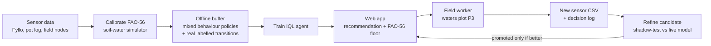

# PANI: Offline Reinforcement Learning for Irrigation Scheduling

**PANI** uses **Implicit Q-Learning (IQL)**, an offline reinforcement-learning method, to decide how much to water greenhouse English cucumber in Telangana, India. It never experiments on the live crop. The agent learns inside a FAO‑56 soil–water simulator calibrated to real sensor data. It is served to the farm through a phone-friendly web app. A safety layer of agronomic rules always sits between the model and the plants.

It was deployed in a three-plot field trial starting in June 2026.

**Author:** Daksh Soodini · [dakshsoodini.github.io](https://dakshsoodini.github.io)

---

## At a glance

| | |
|---|---|
| **Problem** | Small farms irrigate on fixed schedules or by feel. This wastes water when the soil is wet and stresses the crop when it is dry. |
| **Approach** | Calibrate a soil–water simulator to real sensor data, then train an IQL agent offline on simulated plus real transitions. Serve it with FAO‑56 guardrails. |
| **Crop / site** | English cucumber, shade house (25 % shade net), Telangana, transplanted 8 June 2026 |
| **Decisions** | Twice a day (09:00 and 14:00 IST). Output is litres per plant, shown as drip minutes. |
| **Data** | 4-plot Fyllo sensor export (Feb–Apr 2026), 5-pot hand-logged experiment (May 2026), 5-minute field logs (Jun 2026 onward) |
| **Stack** | Python, PyTorch, NumPy/SciPy, pandas, FastAPI |

---

## How it works



1. **Calibrate.** A two-layer FAO‑56 soil–water balance (`src/simulator.py`) is fitted to observed drying curves (`src/calibrate.py`). The fit uses the Fyllo export, the pot experiment and the field logs.
2. **Generate offline data.** Rollouts in the calibrated simulator use a *mixture* of behaviour policies: the FAO‑56 heuristic, random, over-watering and deficit. This gives the dataset coverage of stress, waterlogging and waste. Real transitions with known irrigation amounts are added on top.
3. **Train IQL** (`src/iql.py`, `src/train.py`). Expectile value function (τ = 0.80) and advantage-weighted policy extraction (β = 3.0), following Kostrikov et al., *ICLR 2022*.
4. **Serve** (`webapp/`). The worker uploads the sensor node's SD-card CSV. The app reads plot P3's latest moisture and returns a dose for the next decision window.
5. **Refine safely.** Each upload recalibrates the simulator and fine-tunes a *candidate* model. The candidate replaces the live model only if it beats it on simulated seasons. Bad data is quarantined, and every step is written to an audit log.

### Why IQL?

The historical sensor data records soil moisture and temperature but **not the irrigation actions**, and trial-and-error learning on a live crop is not acceptable. IQL learns entirely from a fixed dataset. It never evaluates `max_a Q(s′, a)`, so it never bootstraps from actions the data does not support. That makes it a conservative choice when the data is small and the cost of a bad action is a damaged crop.

---

## The field trial

| Plot | Treatment | Irrigation |
|---|---|---|
| P1 | **T0** | Farmer's traditional schedule |
| P2 | **T1** | Fixed 12-minute, alternate-day control |
| P3 | **T2** | PANI recommendations (IQL + FAO‑56 floor) |

- **Sensing:** ESP32-based nodes logging soil moisture and temperature at 20 cm, every 5 minutes.
- **Actuation:** no solenoid valve. A worker reads the recommendation at each window and runs the drip line (1 L/h emitters, about one per plant).
- **Measurement:** at each window the worker logs whether the recommendation was followed, and what was done instead if not (`/decide`). They also record their own judgment of how much to water. Together these give a model-vs-farmer comparison.

### What the field taught us

The first deployment surfaced problems that simulation alone did not:

- **The moisture targets were wrong for the real sensors.** The original optimal bands sat about 15 points above anything the probes report. Against 4,753 July readings (median 62.3 %), 87–98 % of a healthy crop's readings scored as "stress". The penalty became a constant the agent could not reduce by watering. The bands, field capacity and wilting point were re-derived from the sensors' observed range.
- **The model never learned to water a dry plot.** The training buffer had 0 of 9,493 rows below 56 % moisture with any water applied. The July model therefore recommended 0 minutes at every moisture level P3 experienced, and P3 went 11 days without irrigation. The fix had two parts:
  - The model was retrained on buffers that contain dry-and-watered examples.
  - An **FAO‑56 agronomic floor** was added: if the model says 0 but moisture is below the depletion trigger (57.6 %), the app serves the FAO‑56 dose instead.

  Every response is tagged `source: "iql"` or `"fao56_floor"`, so the trial can report how often the guardrail fired rather than presenting the result as pure RL.
- **Free hosting loses data.** The host's disk is wiped on every restart, and one farmer judgment was lost this way. The app can now relay judgments to a Google Form as they arrive.

---

## Repository layout

```
smartirrigationresearch/
├── README.md
├── requirements.txt
├── run_training.sh              ← full 200k-step training in resumable chunks
├── benchmark.py                 ← T0 / T1 / T2 comparison in the simulator
├── fyllo.xlsx                   ← Fyllo sensor export, 4 shade plots, hourly (Feb–Apr 2026)
├── configs/
│   └── config.yaml              ← crop, soil, actuator, reward and IQL settings
├── data/
│   ├── soil_log.csv             ← hand-recorded pot experiment (22–26 May 2026)
│   └── TST1234_00{1,2}.csv      ← field sensor logs (5-minute cadence)
├── docs/
│   ├── METHODOLOGY.md           ← derivations, calibration, references
│   └── HARDWARE_GAP.md          ← actuation hardware needed for closed-loop control
├── src/
│   ├── simulator.py             ← two-layer FAO-56 soil-water balance + crop model
│   ├── calibrate.py             ← fit simulator parameters to observed drying curves
│   ├── data_loader.py           ← Fyllo Excel → per-plot timeseries
│   ├── log_loader.py            ← pot-experiment log → labelled transitions
│   ├── field_loader.py          ← field sensor CSVs + event log → transitions
│   ├── obs.py                   ← single source of truth for the 14-D observation
│   ├── env.py                   ← decision-window environment (9 AM / 2 PM, litres)
│   ├── initial_policy.py        ← FAO-56 MAD heuristic (simulator side)
│   ├── initial_policy_deploy.py ← FAO-56 heuristic (field side)
│   ├── iql.py                   ← IQL agent: twin Q, V, policy networks
│   ├── train.py                 ← end-to-end training pipeline
│   ├── online_update.py         ← ingestion, dynamics refit, shadow-test, promote
│   └── deploy.py                ← legacy v1 safety wrapper (pulse-minute actuator; kept for reference)
├── artifacts/ckpts/
│   ├── iql_final.pt             ← deployed IQL checkpoint
│   └── sim_cfg.yaml             ← simulator parameters paired with it
└── webapp/                      ← FastAPI advisory app (see webapp/README.md)
```

---

## Quickstart

Tested with Python 3.13.

```bash
pip install -r requirements.txt
```

**Benchmark the shipped model** in the simulator (under a minute on a laptop CPU):

```bash
python benchmark.py --episodes 30
```

This prints water use, a yield proxy, stress hours and oversaturation hours for three simulated policies:
- **T0:** a fixed 0.5 L/plant every session.
- **T1:** the FAO‑56 heuristic.
- **T2:** the IQL agent.

These are simulator results, not field yields.

**Train from scratch** (200,000 gradient steps, in 25k-step chunks that resume automatically):

```bash
./run_training.sh
```

**Run the web app locally:**

```bash
cd webapp
uvicorn app:app --reload --port 8000
```

Then open <http://localhost:8000>. The researcher view is at `/research`.

---

## Limitations

- **Simulated evaluation.** The benchmark compares policies inside the calibrated simulator. Real-world outcomes come from the field trial, not from these numbers.
- **No yield labels yet.** The reward uses a yield proxy built from root-zone water and stress hours. Once harvest data exists, the reward weights should be re-fitted.
- **Sensor units, not volumetric water content.** The probes' absolute scale is uncalibrated against gravimetric measurements, so moisture targets are expressed in sensor units.
- **Missing weather inputs.** Air temperature, humidity and radiation were not logged. ET₀ therefore uses a temperature-based (Hargreaves-style) surrogate whose radiation term is absorbed by calibration.
- **Small, dry-band-sparse data.** IQL extrapolates where the data is thin. The FAO‑56 floor exists because of this, and how often it fires is a direct measure of the problem.
- **Human-executed actions.** Without a solenoid valve, the dose applied can differ from the dose recommended. The decision log records both.

`docs/METHODOLOGY.md` records the original v1 design, derivations and references in full.

---

## Citation

> Soodini, D. (2026). *PANI: Offline reinforcement learning for irrigation scheduling of greenhouse English cucumber in Telangana.* https://github.com/DakshSoodini/smartirrigationresearch
