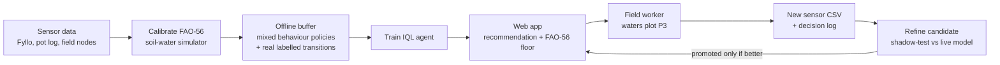
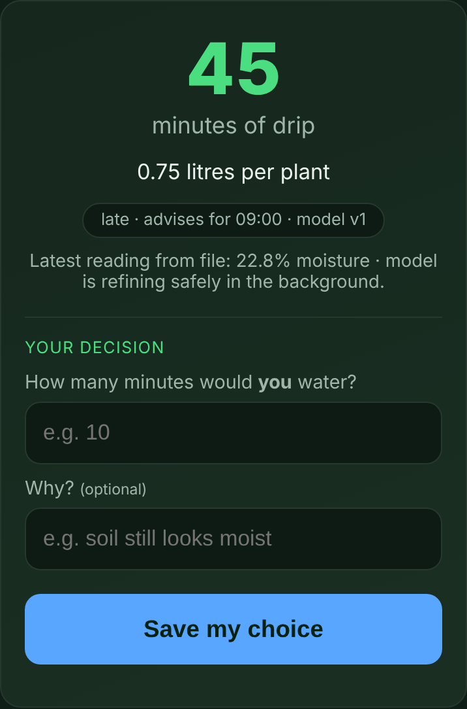
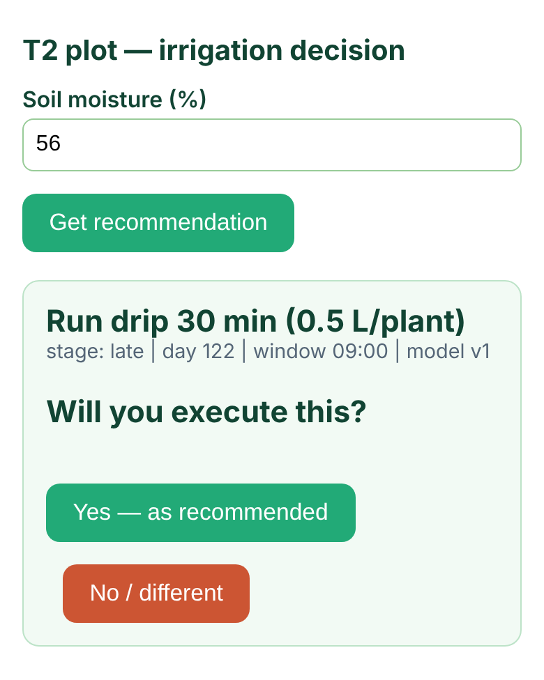
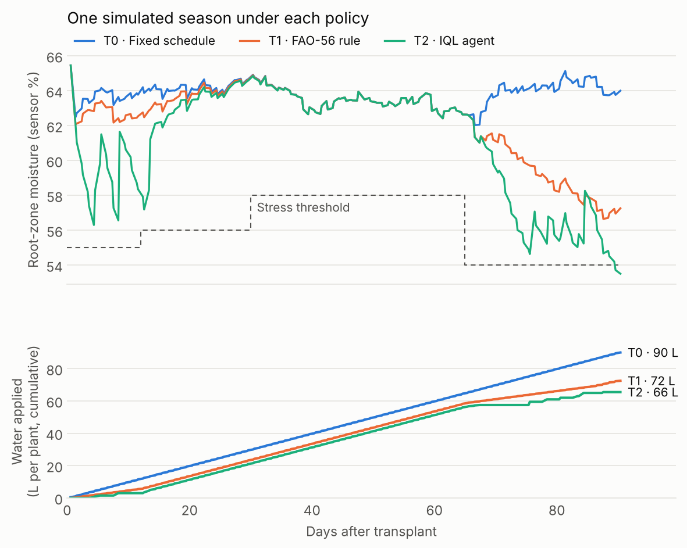

# PANI: Offline Reinforcement Learning for Irrigation Scheduling

**PANI** uses **Implicit Q-Learning (IQL)**, an offline reinforcement-learning method, to decide how much to water greenhouse English cucumber in Telangana, India. It never experiments on the live crop. The agent learns inside a FAO‑56 soil–water simulator calibrated to real sensor data. It is served to the farm through a phone-friendly web app. A safety layer of agronomic rules always sits between the model and the plants.

It was deployed in a three-plot field trial starting in June 2026.

**Author:** Daksh Soodini · [dakshsoodini.github.io](https://dakshsoodini.github.io)

---

## At a glance

| | |
|---|---|
| **Problem** | Small farms irrigate on fixed schedules or by feel. This wastes water when the soil is wet and stresses the crop when it is dry. |
| **Approach** | Calibrate a soil–water simulator to real sensor data, then train an IQL agent offline on simulated plus real transitions. Serve it with FAO‑56 guardrails. |
| **Crop / site** | English cucumber, shade house (25 % shade net), Telangana, transplanted 8 June 2026 |
| **Decisions** | Twice a day (09:00 and 14:00 IST). Output is litres per plant, shown as drip minutes. |
| **Data** | 4-plot Fyllo sensor export (Feb–Apr 2026), 5-pot hand-logged experiment (May 2026), 5-minute field logs (Jun 2026 onward) |
| **Stack** | Python, PyTorch, NumPy/SciPy, pandas, FastAPI |

---

## How it works



1. **Calibrate.** A two-layer FAO‑56 soil–water balance (`src/simulator.py`) is fitted to observed drying curves (`src/calibrate.py`). The fit uses the Fyllo export, the pot experiment and the field logs.
2. **Generate offline data.** Rollouts in the calibrated simulator use a *mixture* of behaviour policies: the FAO‑56 heuristic, random, over-watering and deficit. This gives the dataset coverage of stress, waterlogging and waste. Real transitions with known irrigation amounts are added on top.
3. **Train IQL** (`src/iql.py`, `src/train.py`). Expectile value function (τ = 0.80) and advantage-weighted policy extraction (β = 3.0), following Kostrikov et al., *ICLR 2022*.
4. **Serve** (`webapp/`). The worker uploads the sensor node's SD-card CSV. The app reads plot P3's latest moisture and returns a dose for the next decision window.
5. **Refine safely.** Each upload recalibrates the simulator and fine-tunes a *candidate* model. The candidate replaces the live model only if it beats it on simulated seasons. Bad data is quarantined, and every step is written to an audit log.

### Why IQL?

The historical sensor data records soil moisture and temperature but **not the irrigation actions**, and trial-and-error learning on a live crop is not acceptable. IQL learns entirely from a fixed dataset. It never evaluates `max_a Q(s′, a)`, so it never bootstraps from actions the data does not support. That makes it a conservative choice when the data is small and the cost of a bad action is a damaged crop.

### Technical details

| | |
|---|---|
| **Decision** | Twice a day, at 09:00 and 14:00. Between decisions the simulator steps forward hour by hour with no irrigation. A 90-day season has about 180 decisions. |
| **State (14 numbers)** | Surface and deep soil moisture and their 1-hour changes, soil temperature, time of day (as sine and cosine), days since transplant, growth stage, water already applied today, and which decision window it is. Built in one place, `src/obs.py`, so training and serving can't drift apart. |
| **Actions** | 0, 0.25, 0.5, 1.0, 1.5 or 2.0 litres per plant, with a hard cap of 4 L per plant per day. |
| **Reward** | Penalties for water used, for hours below the stage's target moisture band (water stress), and for hours of waterlogging, plus a yield bonus at the end of the season. The weights are in `configs/config.yaml`. |
| **Offline data** | 400 simulated seasons, generated by four behaviour policies (FAO‑56 rule 40 %, random 20 %, over-watering 20 %, deficit 20 %). Real transitions from the pot experiment and field logs, with known irrigation amounts, are added on top. |
| **Networks** | Twin Q-networks, a value network and a policy network. Each is a 3-layer MLP with 256 units per layer. |
| **Training** | 200,000 gradient steps, batch size 256, learning rate 3 × 10⁻⁴, discount γ = 0.995, expectile τ = 0.80, advantage temperature β = 3.0. |

---

## The field trial

| Plot | Treatment | Irrigation |
|---|---|---|
| P1 | **T0** | Farmer's traditional schedule |
| P2 | **T1** | Fixed 12-minute, alternate-day control |
| P3 | **T2** | PANI recommendations (IQL + FAO‑56 floor) |

- **Sensing:** ESP32-based nodes logging soil moisture and temperature at 20 cm, every 5 minutes.
- **Actuation:** no solenoid valve. A worker reads the recommendation at each window and runs the drip line (1 L/h emitters, about one per plant).
- **Measurement:** at each window the worker logs whether the recommendation was followed, and what was done instead if not (`/decide`). They also record their own judgment of how much to water. Together these give a model-vs-farmer comparison.

### What the field taught us

The first deployment surfaced problems that simulation alone did not:

- **The moisture targets were wrong for the real sensors.** The original optimal bands sat about 15 points above anything the probes report. Against 4,753 July readings (median 62.3 %), 87–98 % of a healthy crop's readings scored as "stress". The penalty became a constant the agent could not reduce by watering. The bands, field capacity and wilting point were re-derived from the sensors' observed range.
- **The model never learned to water a dry plot.** The training buffer had 0 of 9,493 rows below 56 % moisture with any water applied. The July model therefore recommended 0 minutes at every moisture level P3 experienced, and P3 went 11 days without irrigation. The fix had two parts:
  - The model was retrained on buffers that contain dry-and-watered examples.
  - An **FAO‑56 agronomic floor** was added: if the model says 0 but moisture is below the depletion trigger (57.6 %), the app serves the FAO‑56 dose instead.

  Every response is tagged `source: "iql"` or `"fao56_floor"`, so the trial can report how often the guardrail fired rather than presenting the result as pure RL.
- **Free hosting loses data.** The host's disk is wiped on every restart, and one farmer judgment was lost this way. The app can now relay judgments to a Google Form as they arrive.

### The web app

The worker uses two phone pages:
- **Recommendation page:** upload the sensor node's file to get a dose, then record what you would have done.
- **Decision log (`/decide`):** at each window, record whether the recommendation was actually carried out.

<p>
  
  &nbsp;&nbsp;
  
</p>

---

## Results (simulation)

`benchmark.py` runs each policy for 30 simulated seasons. It uses the same simulator parameters the deployed model was trained with (`artifacts/ckpts/sim_cfg.yaml`), except rain (see Limitations).

| Policy | Water per plant per season | Hours of water stress | Yield proxy |
|---|---|---|---|
| T0 · Fixed schedule (0.5 L every session) | 90.0 L | 0 | 37.8 |
| T1 · FAO‑56 rule | 71.3 L | 0 | 37.8 |
| T2 · IQL agent | 67.0 L | 19 on average (median 1; none in 13 of 30 seasons; worst 108) | 37.1 |

The IQL agent uses **26 % less water than the fixed schedule** and 6 % less than the FAO‑56 rule. Most seasons it causes little or no water stress, but in a few the dry spells add up, to 108 hours in the worst season. So on the overall reward it beats the fixed schedule, while the FAO‑56 rule still scores best. This is the same weakness the field trial exposed: the model is least reliable when the soil is dry. That's why the deployed app keeps the FAO‑56 floor. Closing this gap with more real data from dry conditions is the next step.

<picture>
  <source media="(prefers-color-scheme: dark)" srcset="docs/images/simulated-season-dark.png">
  
</picture>

The chart shows one simulated season with the same weather noise for all three policies. The fixed schedule keeps the soil wettest and uses the most water. The IQL agent saves water by holding off early in the season and again late in the season. Near the end of the season it slips just below the stress threshold. Regenerate the chart with `python docs/plot_season.py`.

---

## Repository layout

```
smartirrigationresearch/
├── README.md
├── requirements.txt
├── run_training.sh              ← full 200k-step training in resumable chunks
├── benchmark.py                 ← T0 / T1 / T2 comparison in the simulator
├── fyllo.xlsx                   ← Fyllo sensor export, 4 shade plots, hourly (Feb–Apr 2026)
├── configs/
│   └── config.yaml              ← crop, soil, actuator, reward and IQL settings
├── data/
│   ├── soil_log.csv             ← hand-recorded pot experiment (22–26 May 2026)
│   └── TST1234_00{1,2}.csv      ← field sensor logs (5-minute cadence)
├── docs/
│   ├── METHODOLOGY.md           ← derivations, calibration, references
│   ├── HARDWARE_GAP.md          ← actuation hardware needed for closed-loop control
│   ├── plot_season.py           ← draws the simulated-season chart
│   └── images/                  ← chart and web app screenshots
├── src/
│   ├── simulator.py             ← two-layer FAO-56 soil-water balance + crop model
│   ├── calibrate.py             ← fit simulator parameters to observed drying curves
│   ├── data_loader.py           ← Fyllo Excel → per-plot timeseries
│   ├── log_loader.py            ← pot-experiment log → labelled transitions
│   ├── field_loader.py          ← field sensor CSVs + event log → transitions
│   ├── obs.py                   ← single source of truth for the 14-D observation
│   ├── env.py                   ← decision-window environment (9 AM / 2 PM, litres)
│   ├── initial_policy.py        ← FAO-56 MAD heuristic (simulator side)
│   ├── initial_policy_deploy.py ← FAO-56 heuristic (field side)
│   ├── iql.py                   ← IQL agent: twin Q, V, policy networks
│   ├── train.py                 ← end-to-end training pipeline
│   ├── online_update.py         ← ingestion, dynamics refit, shadow-test, promote
│   └── deploy.py                ← legacy v1 safety wrapper (pulse-minute actuator; kept for reference)
├── artifacts/ckpts/
│   ├── iql_final.pt             ← deployed IQL checkpoint
│   └── sim_cfg.yaml             ← simulator parameters paired with it
└── webapp/                      ← FastAPI advisory app (see webapp/README.md)
```

---

## Quickstart

Tested with Python 3.13.

```bash
pip install -r requirements.txt
```

**Benchmark the shipped model** in the simulator (under a minute on a laptop CPU):

```bash
python benchmark.py --episodes 30
```

This prints water use, a yield proxy, stress hours and oversaturation hours for three simulated policies:
- **T0:** a fixed 0.5 L/plant every session.
- **T1:** the FAO‑56 heuristic.
- **T2:** the IQL agent.

These are simulator results, not field yields. To redraw the season chart, run `python docs/plot_season.py`.

**Train from scratch** (200,000 gradient steps, in 25k-step chunks that resume automatically):

```bash
./run_training.sh
```

**Run the web app locally:**

```bash
cd webapp
uvicorn app:app --reload --port 8000
```

Then open <http://localhost:8000>. The researcher view is at `/research`.

---

## Limitations

- **Simulated evaluation.** The benchmark compares policies inside the calibrated simulator. Real-world outcomes come from the field trial, not from these numbers.
- **No yield labels yet.** The reward uses a yield proxy built from root-zone water and stress hours. Once harvest data exists, the reward weights should be re-fitted.
- **Sensor units, not volumetric water content.** The probes' absolute scale is uncalibrated against gravimetric measurements, so moisture targets are expressed in sensor units.
- **Missing weather inputs.** Air temperature, humidity and radiation were not logged. ET₀ therefore uses a temperature-based (Hargreaves-style) surrogate whose radiation term is absorbed by calibration.
- **Small, dry-band-sparse data.** IQL extrapolates where the data is thin. The FAO‑56 floor exists because of this, and how often it fires is a direct measure of the problem.
- **Human-executed actions.** Without a solenoid valve, the dose applied can differ from the dose recommended. The decision log records both.
- **Rain model not included.** The deployed checkpoint was trained with a version of the simulator that also modelled rain, and that code isn't in this repository. `benchmark.py` therefore runs without rain and prints a note saying so.

`docs/METHODOLOGY.md` records the original v1 design, derivations and references in full.

---

## Project timeline

| When | What happened |
|---|---|
| Feb–Apr 2026 | Soil sensors logged four shade-treatment plots. This data calibrated the first simulator. |
| May 2026 | Pot experiment (5 pots, hand-logged readings, measured 1 L irrigations) gave the first real action labels. |
| 8 Jun 2026 | Cucumber transplanted. The three-plot field trial began. |
| Late Jun 2026 | First IQL model trained and the farm web app built. |
| Jul 2026 | Added the decision log and Google Sheet sync. The IQL arm moved to plot P3. |
| Aug 2026 | Found that the model never watered dry soil. Corrected the moisture scale, retrained the model and added the FAO‑56 floor. |

## Acknowledgements

I did this research with guidance from Prof. Pradeep Varakantham of Singapore Management University. More about this project, Project Paani and my other work is at [dakshsoodini.github.io](https://dakshsoodini.github.io).

---

## Citation

> Soodini, D. (2026). *PANI: Offline reinforcement learning for irrigation scheduling of greenhouse English cucumber in Telangana.* https://github.com/DakshSoodini/smartirrigationresearch
